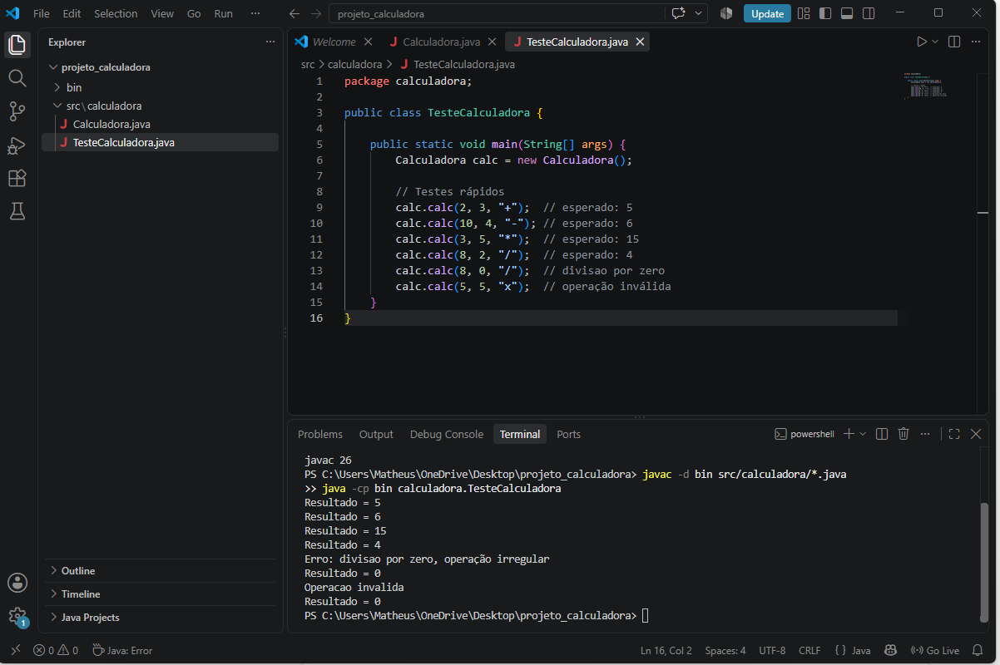
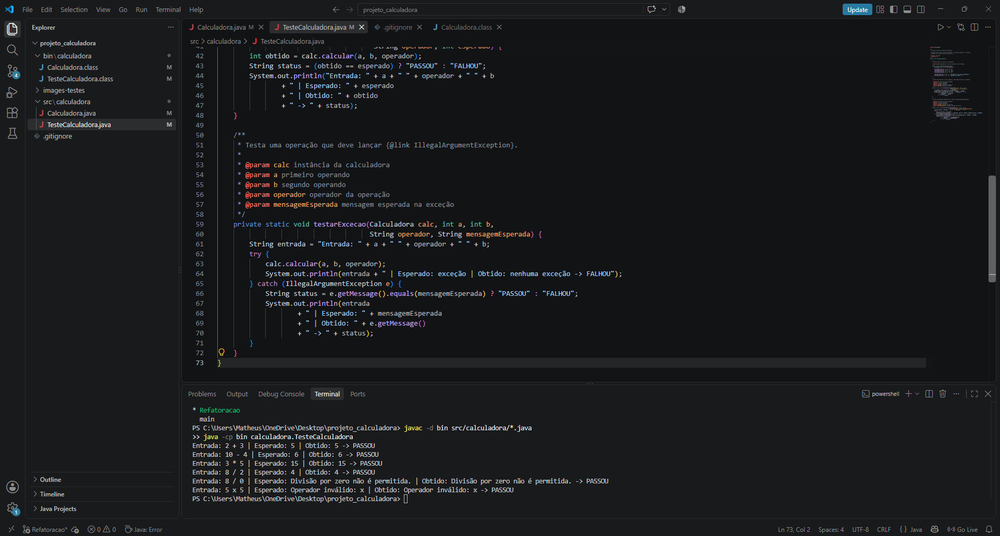
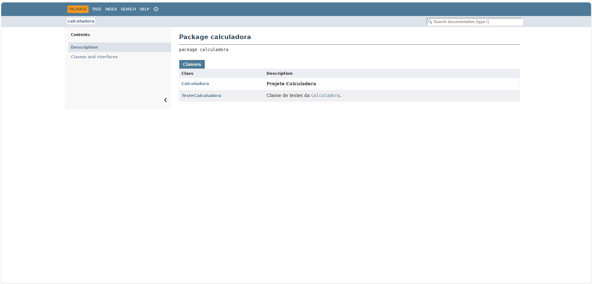
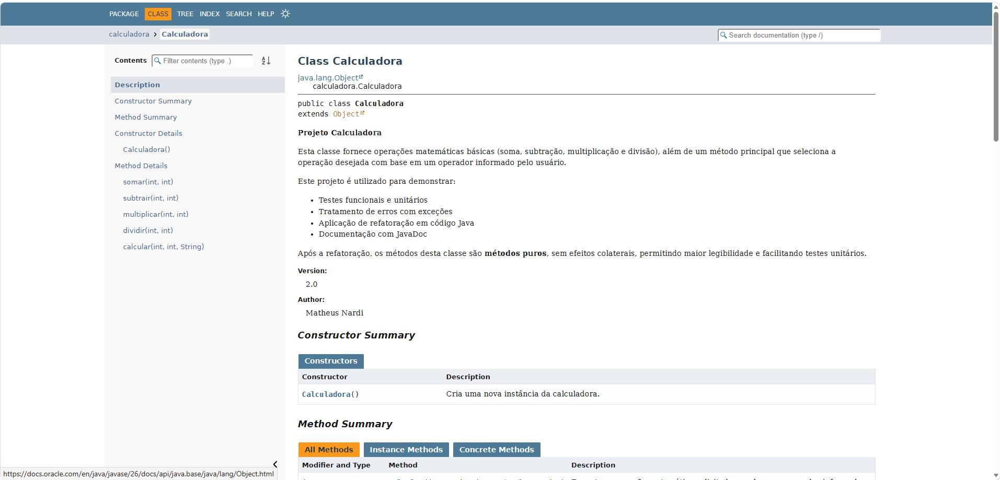

# Projeto Calculadora — FinançApp

> Projeto acadêmico desenvolvido com foco em Qualidade de Software, Testes, Refatoração, Documentação e Versionamento.

---

## 1. Identificação do Projeto

**Projeto:** Projeto Calculadora  
**Contexto:** FinançApp  
**Aluno:** Matheus Bau Nardi  
**RA:** 249221  
**Curso:** Análise e Desenvolvimento de Sistemas  
**Disciplina:** UX/UI e Testes de Software (Turma AS406TSN4)  
**Professor:** Daniel Ohata  
**Semestre:** 4º Semestre — 2026.2  

---

# 2. Visão Geral

O projeto consiste no desenvolvimento de um módulo de cálculos matemáticos básicos em Java para a startup fictícia **FinançApp**.

O módulo foi desenvolvido com o objetivo de ser utilizado futuramente em funcionalidades de controle financeiro, como:

- orçamento mensal;
- divisão de despesas;
- projeções financeiras;
- cálculos auxiliares.

Além do funcionamento correto das operações, o projeto aplica práticas de qualidade de software relacionadas a:

- testes;
- tratamento de erros;
- refatoração;
- documentação;
- versionamento;
- manutenção de código.

---

# 3. Problema

Durante o desenvolvimento da aplicação FinançApp, foi identificada a necessidade de criar um módulo matemático reutilizável.

Entretanto, a empresa definiu que o módulo não deveria apenas funcionar corretamente, mas também apresentar:

- código legível;
- testes executáveis;
- tratamento de falhas;
- documentação técnica;
- controle de versões;
- facilidade de manutenção.

O desafio consiste, portanto, em desenvolver uma solução funcional e ao mesmo tempo aplicar boas práticas de Engenharia de Software.

---

# 4. Objetivo

## 4.1 Objetivo Geral

Desenvolver uma calculadora em Java aplicando práticas de qualidade, testes, documentação, refatoração e versionamento.

## 4.2 Objetivos Técnicos

- implementar operações matemáticas básicas;
- tratar entradas inválidas;
- impedir divisão por zero;
- desenvolver testes unitários;
- refatorar o código sem alterar seu comportamento funcional;
- documentar classes e métodos com JavaDoc;
- gerar documentação HTML;
- utilizar Git e GitHub;
- organizar commits e branches;
- manter documentação técnica no README.

---

# 5. Escopo Funcional

A aplicação oferece as seguintes operações:

| ID | Funcionalidade | Descrição | Status |
|---|---|---|---|
| RF01 | Soma | Soma dois números inteiros | ✅ |
| RF02 | Subtração | Subtrai dois números inteiros | ✅ |
| RF03 | Multiplicação | Multiplica dois números inteiros | ✅ |
| RF04 | Divisão | Divide dois números inteiros | ✅ |
| RF05 | Validação de divisão | Impede divisão por zero | ✅ |
| RF06 | Operação inválida | Trata operadores não suportados | ✅ |

---

# 6. Requisitos Não Funcionais

| ID | Categoria | Requisito |
|---|---|---|
| RNF01 | Qualidade | O código deve possuir organização e legibilidade |
| RNF02 | Testabilidade | As operações devem possuir testes executáveis (classe `TesteCalculadora`) |
| RNF03 | Manutenção | O código deve permitir refatoração sem alteração funcional |
| RNF04 | Documentação | Classes e métodos devem possuir JavaDoc |
| RNF05 | Versionamento | O projeto deve utilizar Git e GitHub |
| RNF06 | Confiabilidade | Erros não devem interromper inesperadamente a execução |

---

# 7. Tecnologias Utilizadas

| Tecnologia | Versão | Utilização |
|---|---|---|
| Java | 26 | Desenvolvimento |
| JDK | 26 | Compilação e geração do JavaDoc |
| Classe de teste com `main` | — | Testes (sem framework externo, conforme a aula) |
| Git | 2.56 | Controle de versão |
| GitHub | — | Repositório remoto |
| JavaDoc | — | Documentação |
| Visual Studio Code | — | Ambiente de desenvolvimento |

---

# 8. Estrutura do Projeto

```text
projeto_calculadora/
│
├── src/
│   └── calculadora/
│       ├── Calculadora.java
│       └── TesteCalculadora.java
│
├── docs/
│   └── index.html
│
├── images/
│   ├── testes/
│   ├── javadoc/
│   └── refatoracao/
│
├── README.md
└── .gitignore
```

---

# 9. Explicação das Operações

A classe `Calculadora` (pacote `calculadora`) realiza as quatro operações básicas com números inteiros.

| Operador | Operação | Método (versão refatorada) | Exemplo |
|---|---|---|---|
| `+` | Soma | `somar(int a, int b)` | `2 + 3 = 5` |
| `-` | Subtração | `subtrair(int a, int b)` | `10 - 4 = 6` |
| `*` | Multiplicação | `multiplicar(int a, int b)` | `3 * 5 = 15` |
| `/` | Divisão inteira | `dividir(int a, int b)` | `8 / 2 = 4` |

O método principal `calcular(int a, int b, String operador)` recebe os dois operandos e o símbolo da operação, e chama o método correspondente.

## Tratamento de erros

| Situação | Versão original | Versão refatorada |
|---|---|---|
| Divisão por zero | Exibe `Erro: divisao por zero, operação irregular` e retorna `0` | Lança `IllegalArgumentException("Divisão por zero não é permitida.")` |
| Operador inválido (ex.: `x`) | Exibe `Operacao invalida` e retorna `0` | Lança `IllegalArgumentException("Operador inválido: x")` |
| Operador `null` | Não tratado | Lança `IllegalArgumentException("Operador não informado.")` |

Nos dois casos o programa **não é interrompido**: na versão original o erro é informado por mensagem, e na versão refatorada a exceção é capturada com `try/catch` pela classe de testes.

---

# 10. Testes

Os testes estão na classe `TesteCalculadora` e cobrem: soma, subtração, multiplicação, divisão, divisão por zero e operação inválida.

## 10.1 Versão original (branch main)

A classe de teste executa seis chamadas e o resultado é conferido com os valores esperados indicados nos comentários do código.

| Entrada | Resultado esperado | Resultado obtido |
|---|---|---|
| `2 + 3` | `5` | `Resultado = 5` |
| `10 - 4` | `6` | `Resultado = 6` |
| `3 * 5` | `15` | `Resultado = 15` |
| `8 / 2` | `4` | `Resultado = 4` |
| `8 / 0` | Mensagem de erro e resultado `0` | `Erro: divisao por zero, operação irregular` / `Resultado = 0` |
| `5 x 5` | Mensagem de operação inválida e resultado `0` | `Operacao invalida` / `Resultado = 0` |

**Print da execução:**



## 10.2 Versão refatorada (branch `Refatoracao`)

Na versão refatorada, a classe `TesteCalculadora` exibe, para cada teste, a **entrada utilizada**, o **resultado esperado**, o **resultado obtido** e o status (`PASSOU` ou `FALHOU`).

| Entrada | Resultado esperado | Resultado obtido | Status |
|---|---|---|---|
| `2 + 3` | `5` | `5` | PASSOU |
| `10 - 4` | `6` | `6` | PASSOU |
| `3 * 5` | `15` | `15` | PASSOU |
| `8 / 2` | `4` | `4` | PASSOU |
| `8 / 0` | `Divisão por zero não é permitida.` | `Divisão por zero não é permitida.` | PASSOU |
| `5 x 5` | `Operador inválido: x` | `Operador inválido: x` | PASSOU |

**Print da execução:**



---

# 11. Refatoração

A refatoração foi feita na branch **`Refatoracao`**, com os testes executados novamente ao final. O comportamento das operações permaneceu correto.

| Técnica aplicada | O que mudou |
|---|---|
| Extração de métodos | A lógica de cada operação saiu do `calc` e foi para `somar`, `subtrair`, `multiplicar` e `dividir` |
| Melhoria de nomes | `calc` → `calcular`; `op` → `operador`; remoção do atributo público `r` |
| Simplificação de condicionais | Cadeia de `if / else if` substituída por `switch` |
| Organização lógica | Os métodos deixaram de imprimir mensagens e passaram a ser métodos puros, sem efeitos colaterais |
| Tratamento de erros | Mensagens e retorno `0` substituídos por `IllegalArgumentException` |

> **Observação:** a divisão por zero e o operador inválido deixaram de retornar `0` com mensagem e passaram a lançar exceção. O resultado das operações válidas não mudou, e a forma de sinalizar erro foi tornada mais segura.

---

# 12. Documentação (JavaDoc)

Todas as classes, métodos, parâmetros, retornos e exceções foram documentados com JavaDoc (`@author`, `@version`, `@param`, `@return` e `@throws`).

A documentação HTML foi gerada na pasta `docs/`, com o comando:

```text
javadoc -d docs -sourcepath src -author -version -encoding UTF-8 -docencoding UTF-8 -charset UTF-8 calculadora
```

Para visualizar, baixe o repositório e abra o arquivo `docs/index.html` no navegador.

**Página do pacote:**



**Página da classe `Calculadora`:**



---

# 13. Como Executar

Na raiz do projeto:

```text
javac -d bin src/calculadora/*.java
java -cp bin calculadora.TesteCalculadora
```

---

# 14. Versionamento

| Branch | Conteúdo |
|---|---|
| `main` | Versão original da calculadora e da classe de teste |
| `Refatoracao` | Versão refatorada, testes atualizados, JavaDoc e documentação |

Os commits seguem o padrão `tipo: descrição` (por exemplo, `feat`, `refactor`, `docs` e `chore`).

---

# 15. Link do Repositório

https://github.com/Matheusnardi10/projeto_calculadora

Branch da refatoração: https://github.com/Matheusnardi10/projeto_calculadora/tree/Refatoracao
